# Detect and Contain: Defender Custom Detection Rules with Automatic Isolation

**Detection engineering project from my LOG(N) Pacific internship.** I built two custom detection rules in Microsoft Defender for Endpoint that catch an attacker creating a backdoor admin account, then respond automatically: one collects forensic evidence, the other cuts the machine off the network. A live test on my own VM went from attack to contained in **about 2 minutes 10 seconds, with no human involved.**

`Microsoft Defender for Endpoint` · `Custom Detection Rules` · `KQL` · `Advanced Hunting` · `Automated Response` · `MITRE ATT&CK` · `Azure`

---

## At a Glance

**The problem:** after breaking in, attackers often create a new local account and add it to the **Administrators** group. Even if the stolen password is changed later, they keep a way back in. In my [case 04](https://github.com/jasonstokes1/soc-analyst-portfolio), one attacker guessed the admin password on 5 servers; this is the next step an attacker like that would take.

**What I built:** two Defender rules with a **tiered response**:
| Rule | Detects | Automatic response |
|---|---|---|
| **1. Local Account Created** (Medium) | A new local user account | Collect an investigation package |
| **2. Local Admin Group Addition** (High) | Any account added to the local Administrators group | **Isolate the device** + collect an investigation package |

**Result:** both rules fired on one simulated attack, in the right order, with the right response. The machine was isolated **1 second** after the alert, and **about 2 minutes 10 seconds** after the attack.

## Skills Demonstrated

`Detection Engineering` · `KQL` · `False-Positive Testing` · `Automated Containment` · `Entity Mapping` · `Incident Timeline Analysis` · `Safe Testing in a Shared Environment`

---

## Key Metrics

| | Result |
|---|---|
| **Attack → device isolated** | **≈ 2 min 10 s** (no human involved) |
| Attack → alert (detection) | 2 min 8 s |
| Alert → isolation submitted (response) | **1 s** |
| Isolation submitted → machine offline | ≤ 1 s |
| Noise removed by filtering on the Administrators SID | **−73%** (290 → 79 alerts per month across the lab) |
| Rule actions taken automatically | **6 of 6** (Action source: *Custom detection*, not *Portal*) |

---

## Executive Summary

Most attackers who break into a Windows machine try to stay. A common way is to create an account and make it an administrator. I wanted Defender to catch that **and act on it immediately**, without waiting for an analyst.

I generated the behavior safely on my own lab VM, found how Defender records it, wrote a query that matches only the real Administrators group (not routine account setup), and measured how noisy the logic would be across the whole lab. I then saved it as two custom detection rules with automatic responses and ran a timed test. Defender detected the attack, isolated the machine and collected forensic evidence on its own.

## My Role

- **Generated** the attacker behavior safely on my own VM (no malware)
- **Found** the telemetry in Defender Advanced Hunting and identified two traps: an automatic "Users" group addition and a blank account-name field
- **Wrote** KQL that filters on the Administrators group's **SID**, not its name, and **measured** the false-positive rate across the whole lab (290 events on ~69 devices)
- **Built** two Defender custom detection rules with entity mapping, MITRE mapping and automated actions
- **Locked** each rule to my own device twice (query + scope), because the lab is shared
- **Tested and timed** the full chain from attack to containment, then released, disabled and cleaned up

---

## 1. Setup

I built a Windows 11 Pro VM, onboarded it to Defender for Endpoint, and allowed Remote Desktop and ping **from my own IP only**. The lab network otherwise allows all inbound traffic, so this network security group was the VM's only filter.

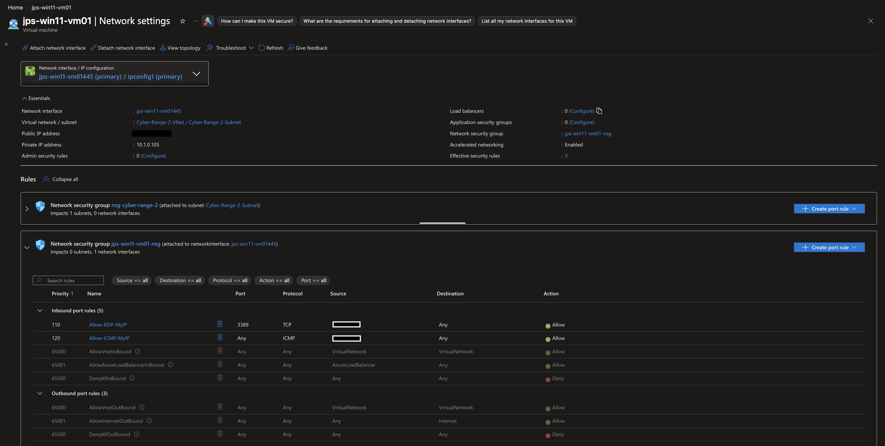

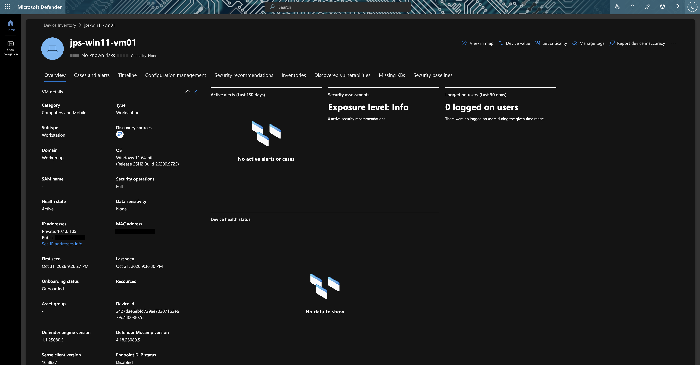

## 2. Generate the Behavior

Two built-in Windows commands reproduce what an attacker does after gaining admin access:

```powershell
net user jps-testadmin '<password>' /add                    # create a local account
net localgroup Administrators jps-testadmin /add            # make it an administrator
```

## 3. Find It in the Telemetry

Defender recorded **5 events in 98 seconds** in the `DeviceEvents` table:

| Time (UTC) | ActionType | What it means |
|---|---|---|
| 20:00:44 | `UserAccountCreated` | The account was created |
| 20:00:45 | `UserAccountModified`, `UserAccountPasswordResetAttempt` | Windows applied default settings and the password |
| 20:00:45 | `UserAccountAddedToLocalGroup` → **Users** (`S-1-5-32-545`) | **Automatic.** Windows does this for every new account |
| 20:02:22 | `UserAccountAddedToLocalGroup` → **Administrators** (`S-1-5-32-544`) | **The attacker step** |

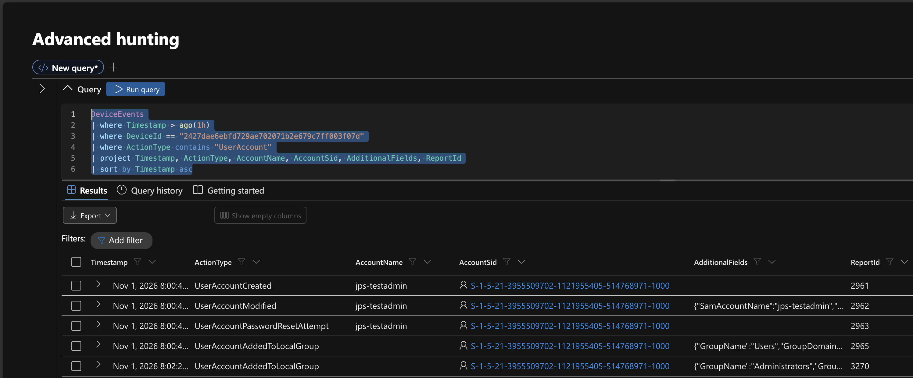

**Three findings shaped the rules:**
1. **A false-positive trap.** A rule on "added to a local group" alone would fire on *every* new account, because of the automatic Users addition.
2. **The added account's name is blank** on group events. It is identified only by its SID, so the rule maps the user entity by SID.
3. **No process was recorded** (`InitiatingProcessFileName` was empty). The rule can tell *what* changed, not *which program* made the change.

<details>
<summary>Show the query</summary>

```kql
DeviceEvents
| where Timestamp > ago(1h)
| where DeviceId == "2427dae6ebfd729ae702071b2e679c7ff003f07d"
| where ActionType contains "UserAccount"
| project Timestamp, ActionType, AccountName, AccountSid, AdditionalFields, InitiatingProcessFileName, InitiatingProcessCommandLine, InitiatingProcessAccountName, ReportId
| sort by Timestamp asc
```
</details>

## 4. Build the Queries

**Why filter on the SID and not the name:** the group's *name* changes with the system language ("Administratoren" in German, "Administradores" in Spanish) and can be renamed. Its SID, **`S-1-5-32-544`**, is the same on every Windows machine.

The Rule 2 query returned exactly **1 row** (the Administrators addition); the automatic Users addition was gone.

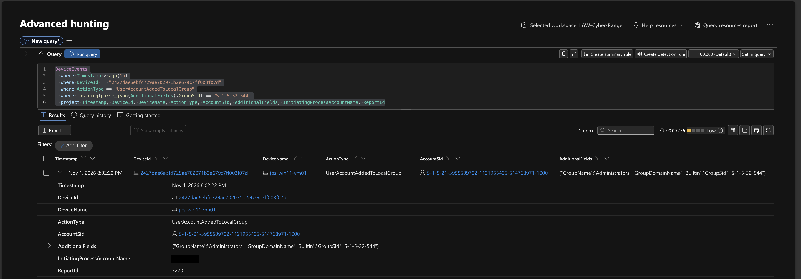

### False-Positive Test

Before automating isolation, I checked how often this logic would fire across **every device in the lab** over 30 days (read-only, counts only):

| | Count |
|---|---|
| Accounts added to any local group | **290** (on ~69 devices) |
| Added to **Administrators** only | **79** |

Filtering on the SID removes **211 of 290 alerts (−73%)**. 79 a month is still too many to auto-isolate in a real company, so each rule is locked to my own device (see Limits for the next tuning step).

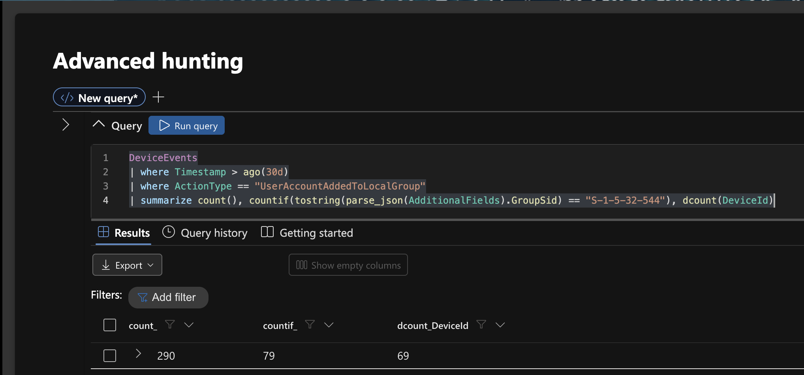

<details>
<summary>Show the query</summary>

```kql
DeviceEvents
| where Timestamp > ago(30d)
| where ActionType == "UserAccountAddedToLocalGroup"
| summarize count(), countif(tostring(parse_json(AdditionalFields).GroupSid) == "S-1-5-32-544"), dcount(DeviceId)
```
</details>

## 5. Create the Rules

Both rules run **Continuous (near real-time)**, map the **Device** (DeviceId) and **User** (SID) entities, and correlate into incidents. Queries: [`queries/rule1-local-account-created.kql`](queries/rule1-local-account-created.kql) and [`queries/rule2-local-admin-group-addition.kql`](queries/rule2-local-admin-group-addition.kql).

| | Rule 1 | Rule 2 |
|---|---|---|
| Name | JPS - Local Account Created | JPS - Local Admin Group Addition |
| Severity | Medium | **High** |
| MITRE | T1136.001 Create Account: Local Account | T1098.007 Account Manipulation: Additional Local or Domain Groups |
| Automatic response | Collect investigation package | **Isolate device (Full)** + collect investigation package |
| Why this level | Admins create accounts legitimately: gather evidence, don't disrupt | Unauthorized admin rights = likely compromise: contain now |

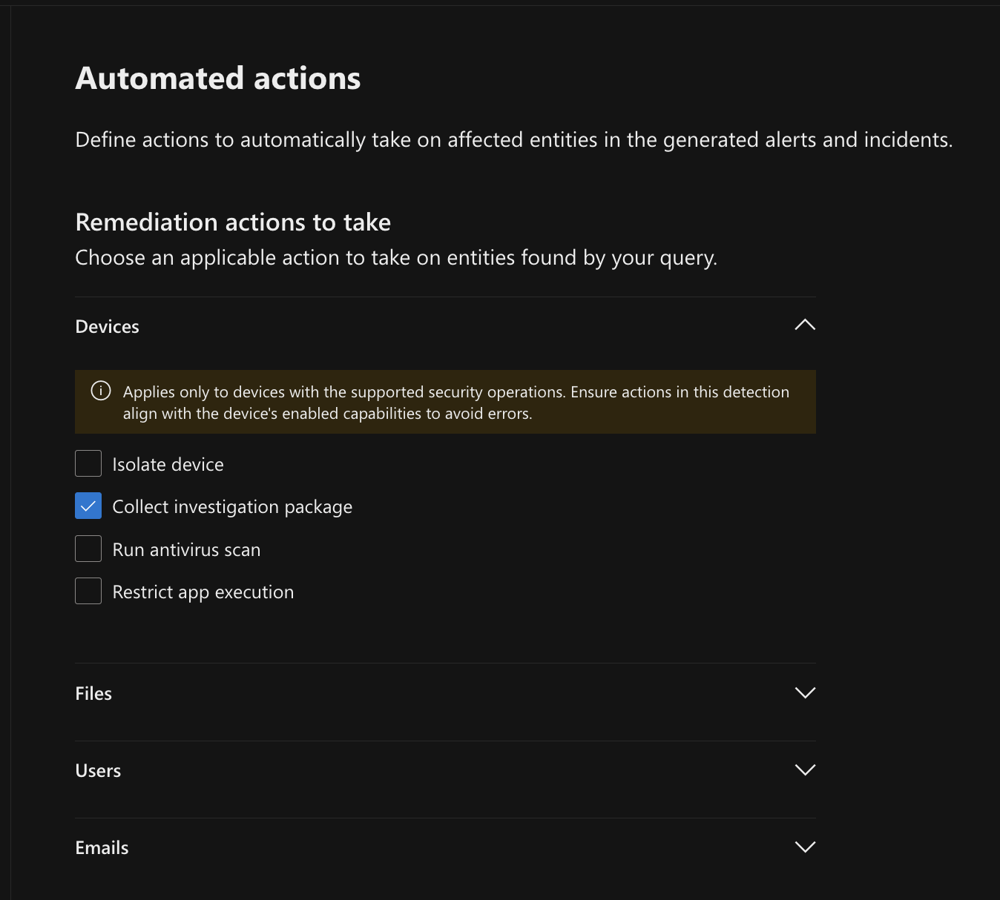

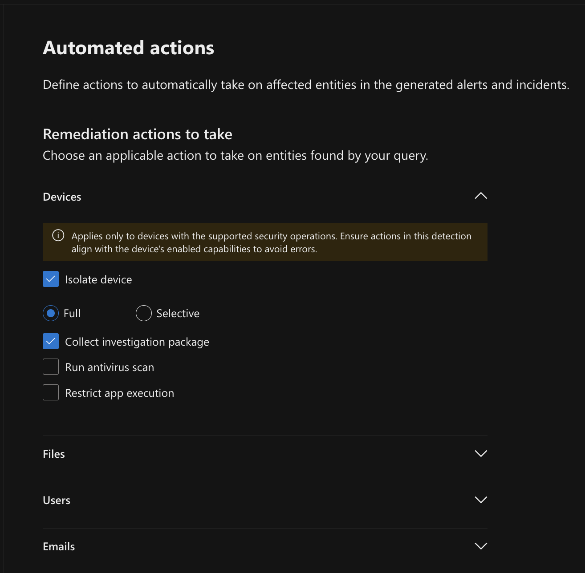

**Safety in a shared lab:** every member's machines report to the same Defender tenant. A rule without a device filter could isolate other people's VMs. Each rule is locked twice: the query matches only my **DeviceId**, and the rule's scope is limited to my device group.

The rules list shows the difference between my earlier Sentinel analytics rules (scheduled, no automated action) and these Defender custom detection rules (near real-time, automated response):

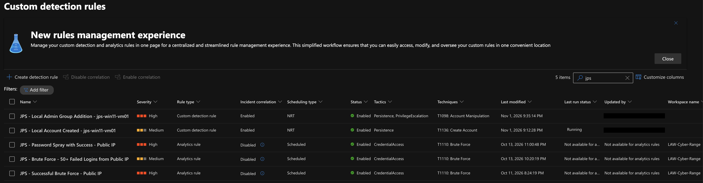

## 6. Test It

I deleted the test account, started a ping with a timestamp on every reply (`ping --apple-time`) so I could see the exact moment the network was cut, and repeated the attack.

| Time (UTC) | Event | Source |
|---|---|---|
| 21:58:38 | Account created | DeviceEvents |
| 21:59:31 | **Account added to Administrators** | DeviceEvents |
| 22:00:21 | Rule 1: investigation package submitted (1 min 43 s after creation) | Action center |
| 22:01:39 | **Rule 2 alert generated** | Alert |
| 22:01:40 | **Isolate device** + investigation package submitted | Action center |
| 22:01:39.97 | Last ping reply from the VM | Ping |
| ~22:01:41 | First ping lost: **machine offline** | Ping |

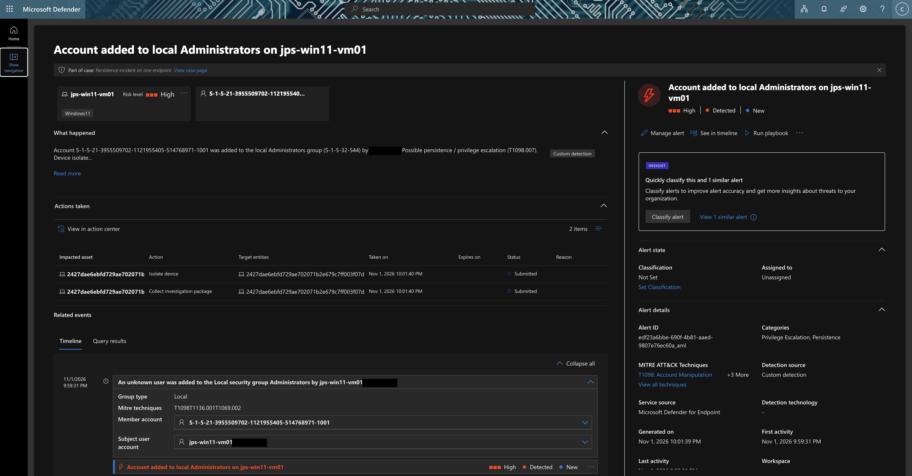

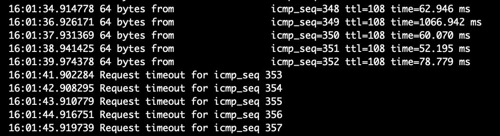

The Action center proves who acted. My manual isolation drill shows **Portal**; every rule action shows **Custom detection action**. Full data: [`evidence/action-center-export-redacted.csv`](evidence/action-center-export-redacted.csv).

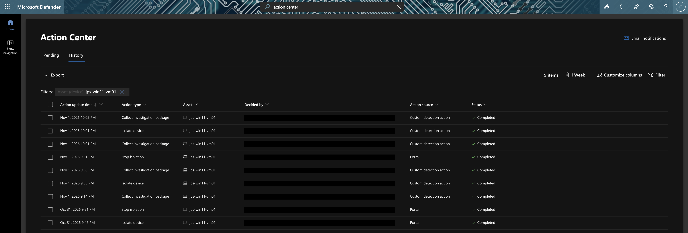

**Where the time goes:** almost all of the 2 min 10 s was **getting the event from the VM into Defender** (detection, 2:08). Once the alert existed, the response took **1 second** and the machine went offline **within a second**. Making this faster means faster telemetry, not faster isolation.

**Independent confirmation:** detection rules run by other teams in the lab, for the same two techniques (T1098 and T1136), also flagged my test activity.

## 7. Clean Up

Released the VM from isolation, **disabled both rules** (kept for evidence), deleted the test account, and classified my alerts as *Informational, expected activity → Security testing*. I then deleted the VM and its network security group.

---

## What the Evidence Can't Show

- **This was a simulated compromise** on my own VM, not a real attacker. The rules are written for real attacks; the test proves the detection and response chain.
- **The rules are locked to one device.** Range-wide, the logic would have fired 79 times in 30 days. Before rolling it out, the next tuning step would be an allowlist of authorized admin accounts or change windows.
- **No process name was recorded** for the group change, so the alert can't say which program (or script) made it.
- The ping shows when the network was cut to within about one second, not to the millisecond.

## Lessons Learned

- **Test the noise before automating the response.** Isolation on a noisy rule would take healthy machines offline.
- **Filter on identifiers, not labels.** A SID works on every Windows machine; a group name doesn't.
- **Look at the raw events first.** The automatic Users addition and the blank account name would both have broken a rule written from memory.
- **Tier the response to the risk.** Evidence collection for a common signal, containment for a high-risk one.
- **Near real-time rules can match events from just before they were saved.** Both rules fired on my setup events within seconds of being created, so a timed test must start from a clean state.
- **In a shared environment, scope everything.** A detection with an automated action is only safe if it can't touch anyone else's machine.

<details>
<summary>Show MITRE ATT&CK mapping</summary>

| Observed | Technique |
|---|---|
| New local account created | T1136.001, Create Account: Local Account |
| Account added to local Administrators | T1098.007, Account Manipulation: Additional Local or Domain Groups |
| Purpose: keep admin access | Persistence (TA0003), Privilege Escalation (TA0004) |
</details>

## Repository Contents

| Folder | Contents |
|---|---|
| `queries/` | Both rule queries plus the hunting and false-positive queries (KQL) |
| `screenshots/` | Evidence screenshots (redacted) |
| `evidence/` | Action center export (redacted) |

<sub>Cyber-range exercise during my Cybersecurity Analyst internship at LOG(N) Pacific. Simulated attack on my own lab VM; no real victims. Screenshots redacted.</sub>
